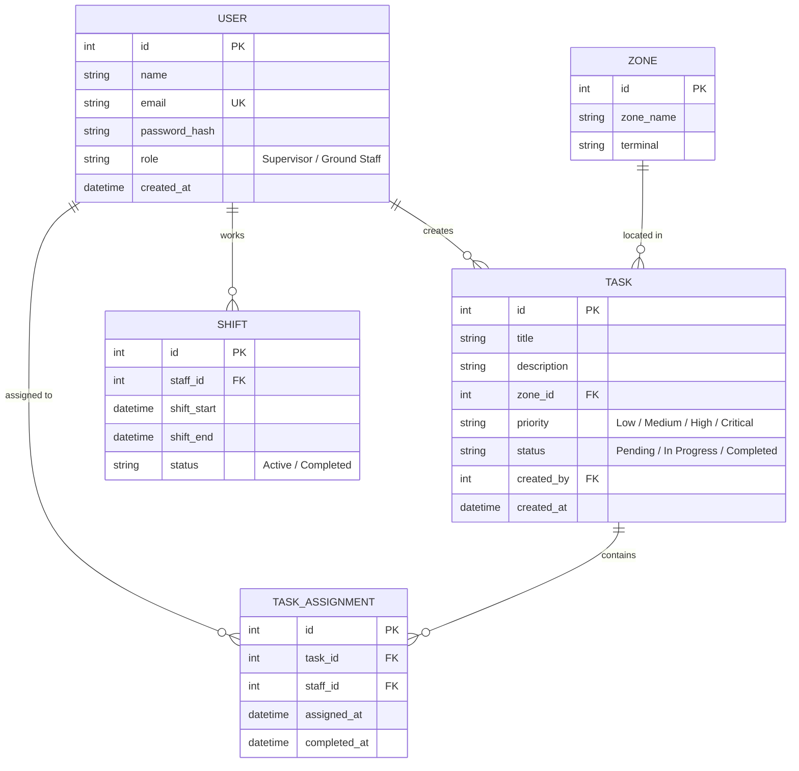

# Entity-Relationship (ER) Diagram

## Entities & Relationships

1. **USER**: Represents ground staff members and supervisors.
2. **TASK**: Ground staff operation tasks created by supervisors.
3. **TASK_ASSIGNMENT**: Junction entity connecting staff to assigned tasks.
4. **SHIFT**: Records staff work shifts and availability windows.
5. **ZONE**: Represents airport terminals and operational zones (e.g. Ramp A, Baggage Hall 2).
