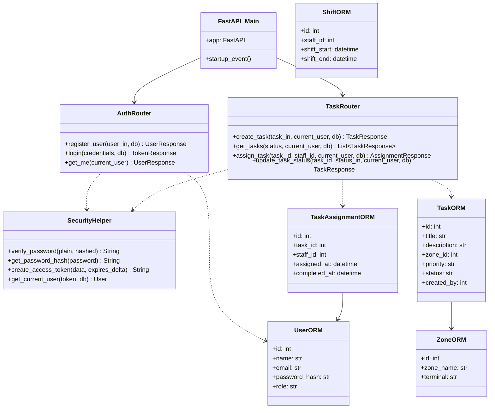

# Class / Module Diagram

## Module Structure

- **`app.core`**: Database initialization & Security token handlers.
- **`app.models`**: SQLAlchemy ORM models matching database tables.
- **`app.schemas`**: Pydantic request & response validation objects.
- **`app.api`**: FastAPI endpoint routers handling business logic.
